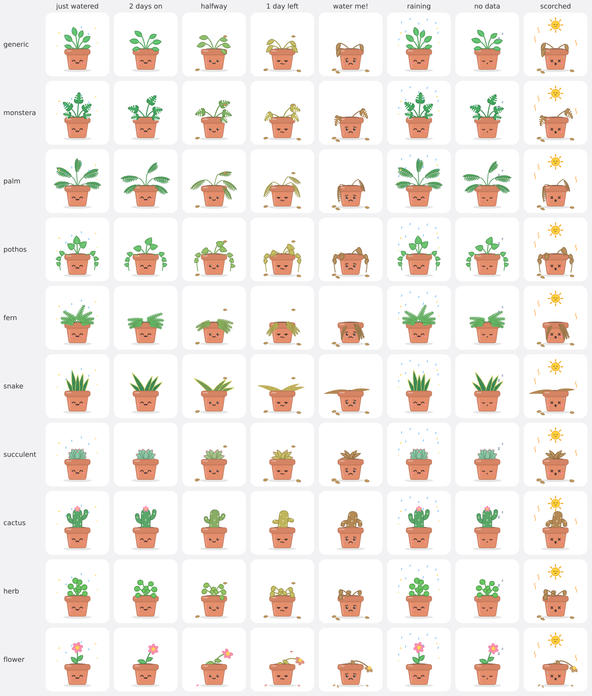

<p align="center">
  <picture>
    <source media="(prefers-color-scheme: dark)" srcset="images/logo-dark.png">
    
  </picture>
</p>

[](https://hacs.xyz)

A tiny Home Assistant card with a potted plant that has a face. Right after you water it the plant stands tall, green and smiling. As the days pass it fades, its leaves droop and fall, and when it's time to water it looks sad and cries a little.

It takes the default size of a 3 × 2 tile in the sections view. Tap the card to log a watering; hold it to open the entity's more-info dialog.



## Features

- **10 plant types**, each drawn differently: generic, monstera, palm, pothos/trailing, fern, snake plant, succulent, cactus, herb, and flowering. In `auto` mode the type is guessed from the card name or the Perenual species (for example "Monstera Salón" draws a monstera and "Albahaca" draws a herb).
- **6 moods**: happy (with sparkles right after watering), fine, tired (sweating, with a leaf falling), sad (crying, leaves on the floor), scorched (✕ ✕ eyes and an O mouth under a blazing sun, when it is hot and the plant needs water), and asleep (no watering logged yet).
- **Sensor bubbles.** Readings from a plant probe (such as a Mi Flora) float around the plant as little bubbles: soil moisture, temperature, air humidity, light, conductivity, battery, and any other numeric sensor. A bubble gets a red ring when its value is out of range. Tap a bubble to open that sensor.
- **Rain-aware for outdoor plants.** Rain since the last watering resets the countdown, and while the weather entity reports rain the card says there's no need to water.
- **Temperature-aware.** In hot weather the countdown gets shorter; in cold weather it gets longer.
- **Perenual** (optional): looks up the species' watering frequency and light needs, and caches the result for 30 days.
- Visual editor, English and Spanish UI, light and dark themes, and `prefers-reduced-motion`.

## Installation

### HACS

1. HACS → ⋮ → *Custom repositories* → add `https://github.com/cruzpazv/cute-plant-card` as type **Dashboard**.
2. Install **Cute Plant Card** and reload the browser.

### Manual

Copy `dist/cute-plant-card.js` to `config/www/`, then add it as a dashboard resource: `/local/cute-plant-card.js`, type *JavaScript module*.

## What you need in Home Assistant

You need one entity per plant (or per group of plants) that records when it was last watered. The simplest is an `input_button` (Settings → Helpers → Button): pressing it stores the current time. An `input_datetime` or a `button` also works.

## Configuration

```yaml
type: custom:cute-plant-card
entity: input_button.regar_monstera
name: Monstera Salón
```

| Option | Default | Description |
|---|---|---|
| `entity` | **required** | `input_button`, `button`, `input_datetime` or timestamp `sensor`: the last watering. Tapping the card presses or sets it. |
| `name` | friendly name | Text under the plant. |
| `species` | `auto` | `auto`, `generic`, `monstera`, `palm`, `pothos`, `fern`, `snake`, `succulent`, `cactus`, `herb`, `flower`. |
| `interval` | from species | Days between waterings. If it's not set, the card uses Perenual, then the plant type's default. |
| `outdoor` | `false` | When `true`, rain counts as watering. |
| `rain_entity` | | Last rain: an `input_datetime`, a timestamp `sensor`, or a rain `binary_sensor`. Used only when `outdoor` is `true`. |
| `weather_entity` | | Its `temperature` attribute adjusts the interval, and a rainy state (when `outdoor` is `true`) shows "no need to water". |
| `temperature_entity` | | A temperature sensor; takes priority over the weather entity's temperature. |
| `hot_temperature` | `28` | At or above this temperature the interval is multiplied by ×0.75; at 5° above it, by ×0.6. |
| `cold_temperature` | `12` | At or below this temperature the interval is multiplied by ×1.3. |
| `days_entity` | | A sensor whose state is the number of days left. If it's set, the card shows that value instead of calculating its own. |
| `perenual_api_key` | | Free key from [perenual.com/docs/api](https://perenual.com/docs/api). |
| `perenual_query` | | Name to search for, such as `monstera deliciosa`. The card uses the first result. |
| `perenual_id` | | Exact species ID; skips the search. |
| `leaf_color`, `pot_color`, `flower_color` | per species | Hex string (`"#7cc47f"`) or `[r, g, b]`. |
| `device_id` | | A plant sensor device. Each of its sensors becomes a bubble (diagnostic ones are skipped, except battery). |
| `plant_entity` | | A `plant.*` entity. Uses its device's sensors, or its `moisture`, `temperature`, `conductivity`, `brightness` and `battery` attributes. |
| `sensors` | | A list of sensor entity IDs to show as bubbles, in addition to the above. |
| `show_bubbles` | `true` | |
| `max_bubbles` | `4` | Bubbles alternate left and right of the plant. On very narrow cards only one per side is shown. |
| `show_name` | `true` | |
| `show_light` | `true` | Light-needs badge: ☀ full sun, ⛅ part shade, ☁ shade. |
| `confirm` | `true` | Ask "Watered it?" before logging. |
| `tap_action` | `water` | Any standard action; `water` is the built-in behaviour. |
| `hold_action` | `more-info` | Any standard action, or `water`. |

### Examples

An outdoor balcony that counts rain and heat:

```yaml
type: custom:cute-plant-card
entity: input_button.regar_plantas_balcon
name: Plantas balcón
outdoor: true
rain_entity: input_datetime.ultima_lluvia
weather_entity: weather.forecast_home
interval: 3
```

Keeping an existing "days left" template sensor:

```yaml
type: custom:cute-plant-card
entity: input_button.regar_plantas_balcon
name: Plantas balcón
outdoor: true
rain_entity: input_datetime.ultima_lluvia
days_entity: sensor.balcon_riego
```

With a Mi Flora sensor. Its temperature also drives the heat adjustment when no weather entity is set:

```yaml
type: custom:cute-plant-card
entity: input_button.regar_monstera
name: Monstera Salón
device_id: 1a2b3c4d5e6f7a8b9c0d
max_bubbles: 4
```

Using species data from Perenual:

```yaml
type: custom:cute-plant-card
entity: input_button.regar_palmera
name: Palmera Dormitorio
perenual_api_key: sk-xxxx
perenual_query: chamaedorea elegans
```

## Perenual notes

- The request goes from your browser straight to perenual.com, and the API allows cross-origin calls. The API key is stored in the dashboard config, so anyone who can edit the dashboard can see it.
- Every species is fetched once and cached in the browser's `localStorage` for 30 days, so a dashboard full of plants won't use up the free daily quota. Failed lookups are retried the next day.
- The free plan doesn't include details for every species. When a species has no data, the card falls back to `interval` and the plant type's defaults; hover over the card to see the reason.

## How the countdown works

```
interval   = interval option, else Perenual, else plant-type default
             × 0.75 or 0.6 if hot, × 1.3 if cold
last       = most recent of: last watering, last rain (outdoors only)
days left  = ceil(interval − days since last)
```

How healthy the plant looks is the fraction of the interval that's left. When there's 1 day left the chip turns amber; at 0 days it turns red and the plant looks sad. If the plant needs water and the temperature is at or above `hot_temperature`, it looks scorched instead.

The temperature comes from `temperature_entity`, else the weather entity, else a temperature bubble.

## Development

`dist/cute-plant-card.js` is the source; there's no build step.

- `docs/demo.html` is a live demo that runs against a fake Home Assistant, with a slider to make days pass. Open it directly from disk.
- `node docs/render-brand.mjs` redraws the icon, logo and social preview from the card's own renderer.
- `node docs/render-preview.mjs` regenerates `images/preview-*.svg` (and the `.png` files, if `rsvg-convert` is installed).

---

### En español

Tarjeta con una planta cuqui en su maceta: recién regada está verde, erguida y contenta. Con los días se va apagando, se le caen las hojas, y cuando toca regar pone cara triste; si además hace mucho calor, ojos ✕ ✕, boca en O y un sol. Los sensores de la planta (humedad, temperatura, luz…) flotan como burbujas. Tiene 10 tipos de planta y tiene en cuenta la lluvia (en exterior) y la temperatura. Con Perenual (opcional) saca cada cuánto hay que regar la especie y cuánta luz necesita. El editor visual está en castellano. Tamaño por defecto: 3 × 2. Toca para registrar un riego; mantén pulsado para ver la entidad.

## License

MIT
